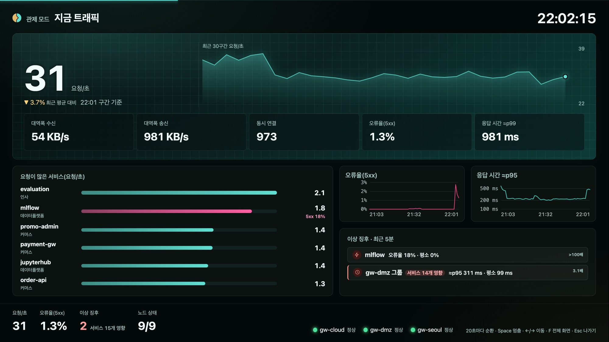

# Symbolon

A gateway that adds sign-in and access checks to internal web services (Symbolon Gateway), and a sign-in server that manages company accounts and groups (Symbolon ID).

**Website:** <https://spro1.github.io/symbolon/en/> · **Status:** 1.0 beta (for evaluation and testing) · [한국어](README.md)



## What Symbolon does

Internal tools and dashboards are often reached directly by server address. Some have no sign-in at all, others each have their own accounts, so it is hard to keep track of who can reach what.

Put Symbolon Gateway in front of your internal services and they get internal domains, HTTPS, sign-in with a company account and group-based access, without changing their code. Users sign in once with their company account and use other internal services without signing in again.

1. The user signs in once with a company account.
2. On every request, the gateway checks who the user is and whether they may use the service.
3. Only requests from verified users are passed to the service. Everyone else sees a notice page.

## Two products

Use them separately or together.

| Product | What it does | On its own |
|---|---|---|
| **Symbolon Gateway** | Opens internal web services on HTTPS addresses and checks sign-in and access on every request before passing it on. | Connects to the standard OIDC sign-in server you already use. |
| **Symbolon ID** | A sign-in (SSO) server that manages your company's users and groups in one place. | Becomes the shared sign-in server for your internal products. |

Used together, turning on sign-in for a service creates the matching Symbolon ID settings automatically, and signing out of Symbolon ID signs the user out of every internal service.

## Features

- **Service registration:** enter a service address and an internal domain, and the registration screen walks you through the rest. Certificates are issued automatically and renewed before they expire.
- **Access policy:** decide per service and path whether sign-in is required, which groups are allowed and whether two-step verification is needed. Check whether a given user would get in before a policy takes effect.
- **Change management:** changes are checked and approved before they take effect, and can be rolled back. Changes that widen access need a security officer's approval.
- **Monitoring:** the dashboard, traffic map and wall display show requests, errors and denied access in near real time.
- **Account management:** users change passwords and set up two-step verification themselves; administrators manage users and groups in the admin console.
- **Audit log:** every administrative action is recorded, and you can verify that the log hasn't been altered.

## Security principles

- Requests are blocked when sign-in or access can't be checked.
- The gateway applies only configuration signed by the management server.
- Administrator accounts in both products require two-step verification.
- Every administrative action is recorded in the audit log.

An independent security review, three rounds of fixes and re-verification are complete; as of release there are no known issues of high severity or above. Details on request.

This does not mean there are no vulnerabilities or that the products hold a security certification. If you find a security problem, please don't post the details in an issue; ask first how to send it privately.

## Status

The current version is **1.0 beta**, for evaluation and testing.

- The only setup tested end to end is the evaluation install on a single machine. Files and guides for virtual machines, containers and Kubernetes are included, but they haven't been tested on real servers yet.
- All testing was done on a single macOS machine. Linux servers and multi-server setups haven't been tested yet.
- A web application firewall, rate limiting, LDAP and Active Directory, SAML, security key sign-in, management server redundancy and installation packages are under consideration after the beta.

## Sizing at a glance

Gateway sizing (number of servers × size of each server). Recommended sizing leaves headroom so service continues if one server stops.

| Tier | Concurrent users | Domains | Minimum | Recommended |
|---|---|---|---|---|
| S Small | ~1,000 | Up to 50 | 1 × 2 vCPU / 2 GB | 2 × 2 vCPU / 2 GB |
| M Medium | ~10,000 | Up to 200 | 2 × 2 vCPU / 4 GB | 2 × 4 vCPU / 4 GB |
| L Large | ~50,000 | Up to 1,000 | 3 × 4 vCPU / 8 GB | 3 × 8 vCPU / 8 GB |
| XL Extra large | 100,000+ | Up to 2,000 per gateway group | 3 × 8 vCPU / 16 GB | 5 × 8 vCPU / 16 GB |

> 1.0 beta estimates — conservatively set at 50% of measurements on a single macOS machine; to be confirmed on Linux servers and in customer PoCs.

## Documents

- **Product overview (Korean PDF):** download it from the [Resources page](https://spro1.github.io/symbolon/en/resources.html).
- The technical overview, feature guide, installation and operations manual, release notes and security review results are available on request for customers evaluating Symbolon. Ask through a [GitHub issue](https://github.com/spro1/symbolon/issues).

## Contact

Questions, suggestions, evaluation requests and document requests go to [GitHub issues](https://github.com/spro1/symbolon/issues). Issues are public, so please don't post personal details such as contact information.

## Made by

Built by independent developer [spro1](https://github.com/spro1), who does the design, implementation and testing alone.

## License

No license has been chosen yet.

## This repository

This repository contains the source of the product website. It does not contain the products' source code.

```sh
python3 build.py            # build src/ into dist/ and check internal links (fails on errors)
python3 build.py --serve    # build, then preview with a local web server
```

Only the Python 3.9+ standard library is needed. Pushing to `main` makes GitHub Actions build the site and publish it to GitHub Pages. Page content is in `src/pages/` (English in `src/pages/en/`), the shared header and footer in `src/layout.html`, and images and PDFs in `src/assets/`. The Sora heading font is licensed under the SIL Open Font License 1.1 ([`src/static/fonts/OFL-Sora.txt`](src/static/fonts/OFL-Sora.txt)).
