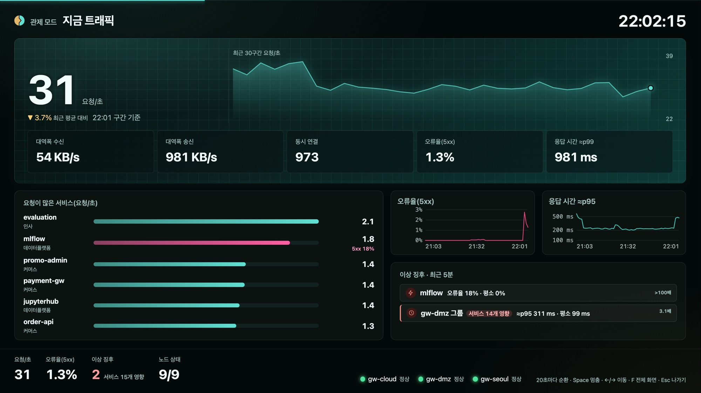

# Symbolon

Symbolon은 두 제품으로 이루어져 있습니다. 사내 웹 서비스에 로그인과 접근 권한 확인을 적용하는 게이트웨이 Symbolon Gateway, 그리고 회사 계정과 그룹을 관리하는 로그인 서버 Symbolon ID입니다.

**웹사이트:** <https://spro1.github.io/symbolon/> · **상태:** 1.0 베타(평가와 검증용) · [English](README.en.md)



## Symbolon이 하는 일

회사 안에서만 쓰는 운영 도구나 대시보드는 서버 주소로 바로 접속하는 경우가 많습니다. 로그인이 없거나 도구마다 계정이 따로 있어서, 누가 어디에 접속할 수 있는지 관리하기 어렵습니다.

Symbolon Gateway를 사내 서비스 앞에 두면 서비스 코드를 고치지 않고도 사내 도메인과 HTTPS, 회사 계정 로그인, 그룹별 접근 권한을 적용할 수 있습니다. 사용자는 회사 계정으로 한 번 로그인하면 여러 사내 서비스를 다시 로그인하지 않고 씁니다.

1. 사용자가 회사 계정으로 한 번 로그인합니다.
2. 게이트웨이가 요청마다 누구인지, 그 서비스에 접속해도 되는지 확인합니다.
3. 확인된 사용자의 요청만 서비스로 전달됩니다. 권한이 없으면 안내 페이지가 표시됩니다.

## 두 제품

두 제품은 따로 쓸 수도 있고 함께 쓸 수도 있습니다.

| 제품 | 하는 일 | 단독으로 쓸 때 |
|---|---|---|
| **Symbolon Gateway** (심볼론 게이트웨이) | 사내 웹 서비스를 HTTPS 주소로 열고, 요청마다 로그인과 접근 권한을 확인한 뒤 서비스로 전달합니다. | 이미 쓰는 표준 OIDC 로그인 서버에 연결합니다. |
| **Symbolon ID** (심볼론 ID) | 회사의 사용자와 그룹을 한곳에서 관리하는 로그인(SSO) 서버입니다. | 여러 사내 제품이 함께 쓰는 로그인 서버가 됩니다. |

함께 쓰면 서비스에 로그인을 켤 때 Symbolon ID 쪽 설정이 자동으로 만들어지고, Symbolon ID에서 로그아웃하면 모든 사내 서비스에서 함께 로그아웃됩니다.

## 주요 기능

- **서비스 등록:** 서비스 주소와 사내 도메인을 입력하면 나머지 설정은 등록 화면이 단계별로 안내합니다. 인증서는 자동으로 발급되고 만료 전에 갱신됩니다.
- **접근 정책:** 서비스와 경로마다 로그인 여부, 허용 그룹, 2단계 인증 요구를 정합니다. 반영하기 전에 특정 사용자가 접속할 수 있는지 미리 확인할 수 있습니다.
- **변경 관리:** 설정 변경은 검증과 승인을 거쳐 반영되고, 문제가 생기면 이전 상태로 되돌립니다. 접근 범위를 넓히는 변경은 보안 담당자의 승인이 필요합니다.
- **모니터링:** 대시보드, 트래픽 맵, 관제 모드에서 요청량과 오류, 거부된 접근을 실시간에 가깝게 확인합니다.
- **계정 관리:** 사용자는 비밀번호 변경과 2단계 인증 등록을 직접 하고, 관리자는 사용자와 그룹을 관리 콘솔에서 관리합니다.
- **감사 기록:** 관리 작업은 모두 기록으로 남고, 기록이 변조되지 않았는지 검증할 수 있습니다.

## 보안 원칙

- 로그인이나 권한을 확인할 수 없으면 요청을 통과시키지 않습니다.
- 게이트웨이는 관리 서버가 서명한 설정만 적용합니다.
- 두 제품 모두 관리자 계정은 2단계 인증을 거쳐야 쓸 수 있습니다.
- 관리 작업은 모두 감사 기록으로 남습니다.

독립 보안 리뷰, 세 차례의 수정과 수정 재검증을 거쳤으며, 출시 시점 기준 알려진 높은 심각도 이상의 문제는 없습니다. 상세는 요청 시 제공합니다.

취약점이 전혀 없다거나 보안 인증을 받았다는 뜻은 아닙니다. 보안 문제를 발견하셨다면 이슈에 자세한 내용을 적지 마시고, 먼저 비공개로 전달할 방법을 물어 주세요.

## 상태

지금 버전은 평가와 검증을 위한 **1.0 베타**입니다.

- 처음부터 끝까지 검증한 구성은 장비 한 대에 설치하는 평가판뿐입니다. 가상 머신과 컨테이너용 파일, Kubernetes 안내 문서는 준비되어 있지만 실제 서버에서의 검증은 아직 진행하지 않았습니다.
- 시험은 모두 macOS 장비 한 대에서 진행했습니다. Linux 서버와 여러 대로 구성한 환경은 아직 확인하지 않았습니다.
- LDAP·Active Directory 연동, SAML, 보안 키 로그인, 관리 서버 이중화, 설치 패키지는 베타 이후에 검토합니다.

## 권장 사양 한눈에 보기

게이트웨이 사양입니다(서버 수 × 서버 한 대의 사양). 권장 사양은 서버 한 대가 멈춰도 서비스가 이어지도록 여유를 둔 구성입니다.

| 규모 | 동시 사용자 | 도메인 | 최소 | 권장 |
|---|---|---|---|---|
| S 소규모 | ~1,000 | 50개 이하 | 1 × 2 vCPU / 2 GB | 2 × 2 vCPU / 2 GB |
| M 중규모 | ~10,000 | 200개 이하 | 2 × 2 vCPU / 4 GB | 2 × 4 vCPU / 4 GB |
| L 대규모 | ~50,000 | 1,000개 이하 | 3 × 4 vCPU / 8 GB | 3 × 8 vCPU / 8 GB |
| XL 초대규모 | 100,000+ | 게이트웨이 그룹당 2,000개 이하 | 3 × 8 vCPU / 16 GB | 5 × 8 vCPU / 16 GB |

> 1.0 베타 기준 산정치 — macOS 단일 장비 실측을 바탕으로 실측의 50%로 보수적으로 잡은 값. Linux 서버 실측과 고객 PoC에서 확정합니다.

## 자료

- **제품소개서(PDF):** [웹사이트의 자료 페이지](https://spro1.github.io/symbolon/resources.html)에서 받을 수 있습니다.
- 기술 소개서, 기능 설명서, 설치·운영 매뉴얼, 릴리스 노트와 보안 리뷰 결과는 도입을 검토하는 고객에게 요청 시 제공합니다. [GitHub 이슈](https://github.com/spro1/symbolon/issues)로 요청해 주세요.

## 문의

질문, 제안, 평가판 사용, 자료 요청은 [GitHub 이슈](https://github.com/spro1/symbolon/issues)로 받습니다. 이슈는 누구나 볼 수 있으니 연락처 같은 개인 정보는 적지 마세요.

## 만든 사람

개인 개발자 [spro1](https://github.com/spro1)이 만들고 있습니다. 설계와 구현, 시험까지 혼자 진행합니다.

## 라이선스

라이선스는 아직 정하지 않았습니다.

## 이 저장소

이 저장소에는 제품 소개 웹사이트의 소스가 들어 있습니다. 제품의 소스 코드는 들어 있지 않습니다.

```sh
python3 build.py            # src/ → dist/ 빌드와 내부 링크 점검(오류가 있으면 실패)
python3 build.py --serve    # 빌드 후 로컬 웹 서버로 미리 보기
```

Python 3.9 이상의 표준 라이브러리만 씁니다. `main`에 push하면 GitHub Actions가 사이트를 빌드해 GitHub Pages에 올립니다. 페이지 본문은 `src/pages/`, 공통 머리글과 바닥글은 `src/layout.html`, 그림과 PDF는 `src/assets/`에 있습니다. 영문 제목 글꼴 Sora는 SIL Open Font License 1.1을 따릅니다([`src/static/fonts/OFL-Sora.txt`](src/static/fonts/OFL-Sora.txt)).
